# OOP2023
### Homework1
```java
public class Homework1 {

	public static void main(String []args){

		int i, j;

		for(i=0; i<10; i++) {

			  for(j=0; j<=i; j++) {

			    System.out.print(" ");

			  }

			  for(; j<=10; j++) {

			    System.out.print("#");

			  }

			  System.out.println();

			}

		for(i=0; i<10; i++) {

			  for(j=0; j<=10-i; j++) {

			    System.out.print(" ");

			  }

			  for(; j<=10; j++) {

			    System.out.print("#");

			  }

			  System.out.println();

			}

		for(i=0; i<10; i++) {

			  for(j=0; j<=10-i; j++) {

			    System.out.print("#");

			  }

			  for(; j<=10; j++) {

			    System.out.print("");

			  }

			  System.out.println();

			}

		for(i=0; i<10; i++) {

			  for(j=0; j<=10-i; j++) {

			    System.out.print("");

			  }

			  for(; j<=10; j++) {

			    System.out.print("#");

			  }

			  System.out.println();

			}

	}

}
```
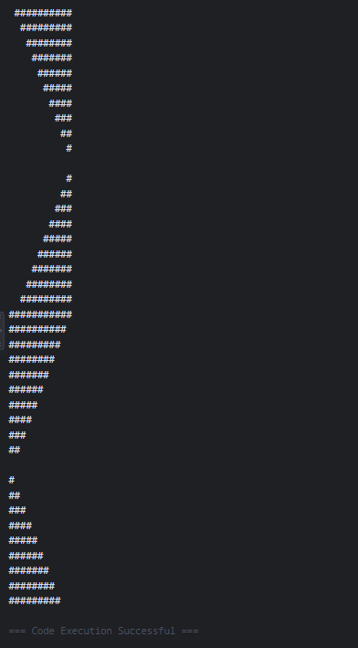

### Homework2
```java
public class homework2 {
    public static void main(String[] args) {
        int n = 20; 
        
        long first = 1;
        long second = 1;
        
        for (int i = 0; i < n; i++) {
            System.out.print(first + " ");

            long next = first + second;
            first = second;
            second = next;
        }
    }
}
```
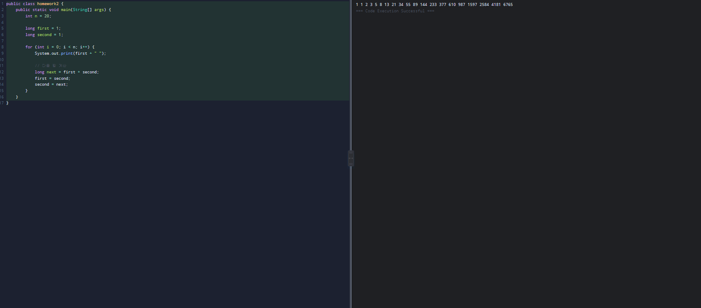

### Homework3
```java
public class Homework3 {
    public static void main(String[] args) {
        int n = 20; 
        
        long first = 1;
        long second = 1;
        
        for (int i = 1; i <= n; i++) {
            if (i == 1) {
            } else {
                long next = first + second;
                double ratio = (double) second / first;
                
                System.out.printf("%d / %d\t\t%.10f\n", second, first, ratio);
                
                first = second;
                second = next;
            }
        }
    }
}
```
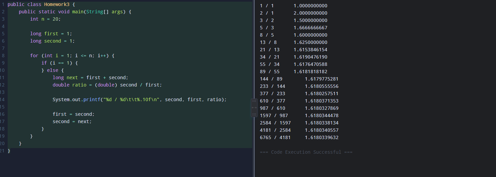

### Homework4
```java
public class Homework4 {
    public static void main(String[] args) {
        for (int i = 1; i <= 9; i++) {
            System.out.println("=== " + i + " ===");
            for (int j = 1; j <= 9; j++) {
                System.out.printf("%d x %d = %d\n", i, j, i * j);
            }
            System.out.println();
        }
    }
}
```
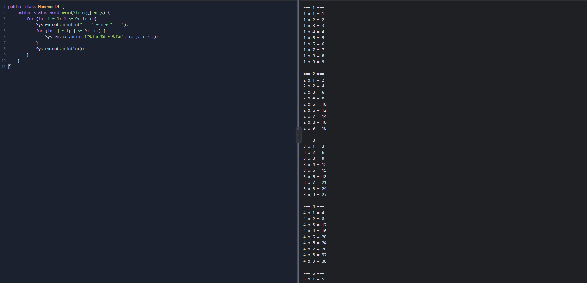

### Homework5
```java
public class homework5 {
    public static void main(String[] args) {
        String fountain = "pi = ";
        int sign = 1;

        // 분모
        for (int i = 1; i <= 30; i += 2) {
            if (i == 1) {
               fountain += "4/1";
            } else {
                // sign이 양수면 +, 음수면 - 기호 붙이기
                if (sign > 0) {
                    fountain += " + 4/" + i;
                } else {
                    fountain += " - 4/" + i;
                }
            }
            sign = -sign; // 다음 항을 위해 부호 반전
        }

        System.out.println(fountain);
    }
}
```
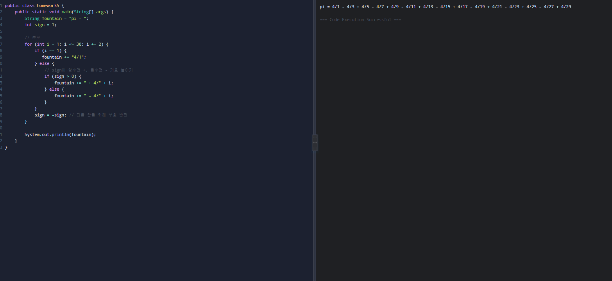

### Homework6
```java
public class homework6 {
    public static void main(String[] args) {
        int n = 7; // 출력할 행의 수 (0승부터 6승까지)
        int[][] binomial = new int[n][];

        // 1. 이항계수 배열 생성 및 파스칼의 삼각형 계산
        for (int i = 0; i < n; i++) {
            binomial[i] = new int[i + 1]; 
            binomial[i][0] = 1;         
            binomial[i][i] = 1;         

          
            for (int j = 1; j < i; j++) {
                binomial[i][j] = binomial[i - 1][j - 1] + binomial[i - 1][j];
            }
        }

        // 2. 파스칼의 삼각형 이항계수 출력
        for (int i = 0; i < n; i++) {
            for (int j = 0; j <= i; j++) {
                System.out.print(binomial[i][j] + " ");
            }
            System.out.println();
        }

        System.out.println(); 

       
        for (int i = 2; i <= 4; i++) {
            System.out.print("(a+b)^" + i + "=");

            for (int j = 0; j <= i; j++) {
                int coeff = binomial[i][j]; 
                int aExp = i - j;          
                int bExp = j;                

              
                if (j > 0) {
                    System.out.print("+");
                }

             
                if (coeff > 1) {
                    System.out.print(coeff);
                }

              
                if (aExp == 1) {
                    System.out.print("a");
                } else if (aExp > 1) {
                    System.out.print("a^" + aExp);
                }

              
                if (bExp == 1) {
                    System.out.print("b");
                } else if (bExp > 1) {
                    System.out.print("b^" + bExp);
                }
            }
            System.out.println();
        }
    }
}
```
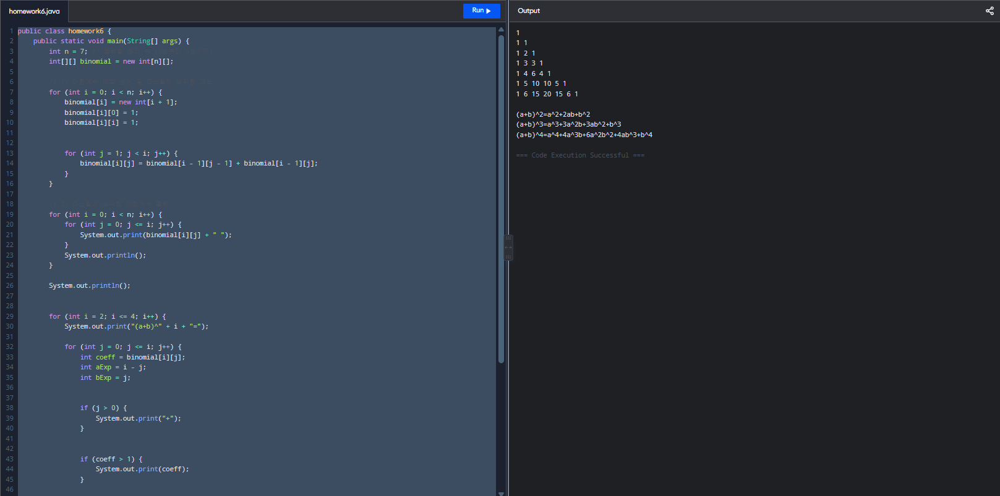

### Homework7
```java
public class homework7 {
    public static void main(String[] args) {
        int data[] = new int[20];

        // 1. 랜덤
        for (int i = 0; i < 20; i++) {
            data[i] = (int) (Math.random() * 100);
        }

        // 2. 선택 정렬 전
        System.out.println("before");
        for (int i = 0; i < 20; i++) {
            System.out.print(data[i] + " ");
        }
        System.out.println("\n");

        // 3. 선택 정렬 알고리즘
        for (int i = 0; i < data.length - 1; i++) {
            int minimum = i; // 최솟값의 위치 기록

            for (int j = i + 1; j < data.length; j++) {
                if (data[j] < data[minimum]) {
                    minimum = j; // 더 작은 값을 찾으면 인덱스 갱신
                }
            }

            // 최솟값과 현재 위치(i)의 값을 교환(Swap)
            int temp = data[minimum];
            data[minimum] = data[i];
            data[i] = temp;
        }

        // 4. 정렬 후 배열 출력
        System.out.println("after");
        for (int i = 0; i < 20; i++) {
            System.out.print(data[i] + " ");
        }
        System.out.println();
    }
}


```
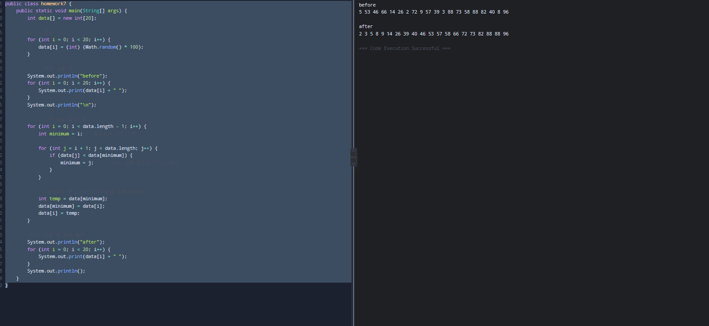

### Homework8
```java
public class Homework8 {
    public static void main(String[] args) {
        int students = 5; // 학생 수
        int subjects = 4;  // 과목 수 (국어, 영어, 수학, 과학)
        
        // 30명 x 4과목 2차원 배열 선언
        int[][] score = new int[students][subjects];
        
        // 과목별 합계를 저장할 배열 (0:국어, 1:영어, 2:수학, 3:과학)
        int[] subjectSum = new int[subjects];

        // 1. 성적 랜덤 생성 (0~100)
        for (int i = 0; i < students; i++) {
            for (int j = 0; j < subjects; j++) {
                score[i][j] = (int) (Math.random() * 101); // 0~100점
            }
        }

        // 헤더 출력
        System.out.println("Num\tK\tE\tM\tS\ttotal");
        System.out.println("-------------------------------------------");

        // 2. 학생별 성적 출력 및 총점/과목별 합계 계산
        for (int i = 0; i < students; i++) {
            int studentSum = 0; // 개인별 합계
            
            System.out.print((i + 1) + "\t"); // 학생 번호 (1~30)
            
            for (int j = 0; j < subjects; j++) {
                System.out.print(score[i][j] + "\t");
                studentSum += score[i][j];      // 개인 합계 누적
                subjectSum[j] += score[i][j];   // 과목별 합계 누적
            }
            
            System.out.println(studentSum); // 개인 총점 출력
        }

        System.out.println("-------------------------------------------");

        // 3. 과목별 평균 계산 및 출력
        System.out.print("a\t"); //평균
        for (int j = 0; j < subjects; j++) {
            double avg = (double) subjectSum[j] / students; // 과목별 평균
            System.out.printf("%.1f ", avg);               
        }
        System.out.println();
    }
}

```
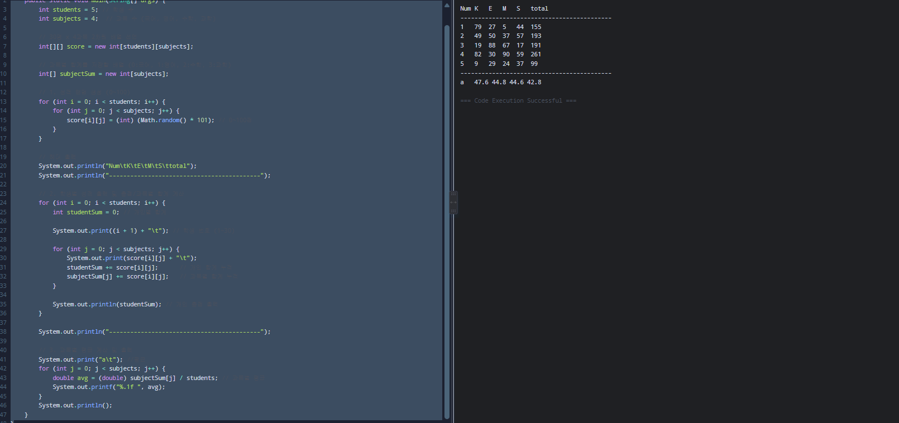

### Homework9

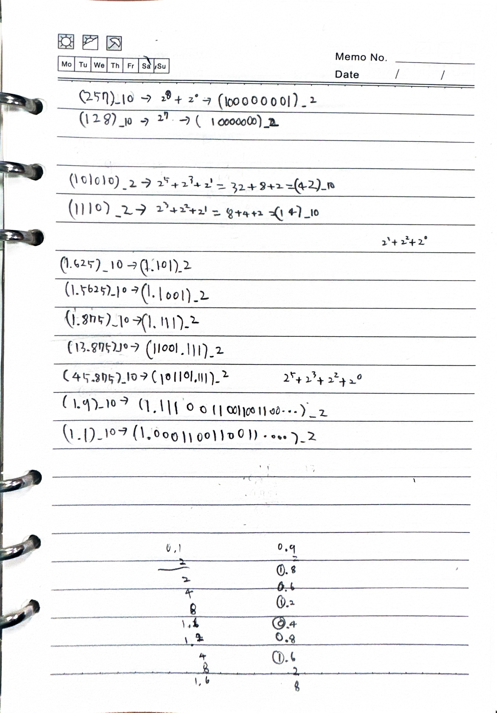

### Homework10

public class Histogram {
    public static void main(String[] args) {
        int array_count, max_value, bin_size, display_scale, hist_size;
        
        // 명령행 인수가 4개 들어오면 그 값을 사용하고, 아니면 기본값 사용
        if (args.length == 4) {
            array_count = Integer.parseInt(args[0]);
            max_value = Integer.parseInt(args[1]);
            bin_size = Integer.parseInt(args[2]);
            display_scale = Integer.parseInt(args[3]);
        } else {
            System.out.println("※ 매개변수가 입력되지 않아 기본값(100 100 10 1)으로 실행합니다.\n");
            array_count = 100;
            max_value = 100;
            bin_size = 10;
            display_scale = 1;
        }
        
        hist_size = max_value / bin_size;
        
        int[] arr = new int[array_count];
        int[] hist = new int[hist_size];
        
        // 1. 난수 생성 및 배열에 저장
        for (int i = 0; i < array_count; i++) {
            arr[i] = (int) (Math.random() * max_value);
        }
        
        // 2. 도수분포 계산
        for (int i = 0; i < array_count; i++) {
            hist[arr[i] / bin_size]++;
        }
        
        // 3. 도수분포표(히스토그램) '#'으로 가로 출력
        for (int i = 0; i < hist_size; i++) {
            // 구간(Range) 계산
            int startRange = i * bin_size;
            int endRange = startRange + bin_size - 1;
            
            // 구간 텍스트 출력
            System.out.printf("%2d~%-2d\t", startRange, endRange);
            
            // display_scale을 적용하여 출력할 '#'의 개수 계산
            int hashCount = hist[i] / display_scale;
            
            // '#' 가로로 출력
            for (int j = 0; j < hashCount; j++) {
                System.out.print("#");
            }
            System.out.println();
        }
    }
}

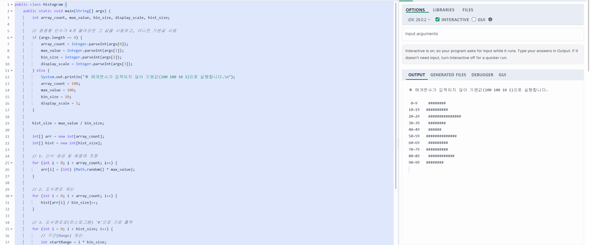


### Homework11

import java.util.Arrays;

public class MeanCalculator {
    public static void main(String[] args) {
        int array_count;
        
        if (args.length == 1) {
            array_count = Integer.parseInt(args[0]);
        } else {
            System.out.println("※ 배열 크기.\n");
            array_count = 10;
        }

        if (array_count <= 0) return;

        int[] arr = new int[array_count];
        
        // 0이 나오면 기하/조화평균 계산이 불가능하므로 난수 범위는 1~100으로 설정
        for (int i = 0; i < array_count; i++) {
            arr[i] = (int) (Math.random() * 100) + 1;
        }

        System.out.print("생성된 데이터: ");
        for (int i = 0; i < array_count; i++) {
            System.out.print(arr[i] + " ");
        }
        System.out.println("\n");

        // 1. 산술평균 (Arithmetic Mean)
        double sum = 0;
        for (int i = 0; i < array_count; i++) {
            sum += arr[i];
        }
        double arithmeticMean = sum / array_count;
        System.out.printf("Arithmetic Mean : %f\n", arithmeticMean);

        // 2. 기하평균 (Geometric Mean)
        double prod = 1.0;
        for (int i = 0; i < array_count; i++) {
            prod *= arr[i];
        }
        double geometricMean = Math.pow(prod, 1.0 / array_count);
        System.out.printf("Geometric Mean  : %f\n", geometricMean);

        // 3. 조화평균 (Harmonic Mean)
        double harmonicSum = 0;
        for (int i = 0; i < array_count; i++) {
            harmonicSum += 1.0 / arr[i]; // 역수의 합
        }
        double harmonicMean = array_count / harmonicSum;
        System.out.printf("Harmonic Mean   : %f\n", harmonicMean);

        // 4. 중앙값 (Median)
        Arrays.sort(arr); // 중앙값을 구하기 위해 배열 오름차순 정렬
        double median;
        if (array_count % 2 == 0) {
            // 짝수 개일 경우 가운데 두 값의 평균
            median = (arr[array_count / 2 - 1] + arr[array_count / 2]) / 2.0;
        } else {
            // 홀수 개일 경우 정확히 가운데 있는 값
            median = arr[array_count / 2];
        }
        System.out.printf("Median          : %f\n", median);
    }
}

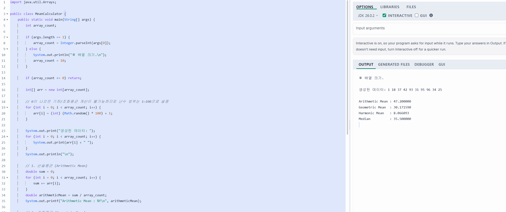

### Homework12

int 78 = 64 + 8 + 6 = 01001110
int -78 = 10110001 + 1 =10110010

### Homework13

import java.util.Scanner;

public class MiniCalculator {
    public static void main(String[] args) {
        Scanner scanner = new Scanner(System.in);
        System.out.println("계산식을 입력하세요 (종료하려면 exit 입력).");
        System.out.println("예시: 2 + 3, 32 # 56, 2 + 4 # 7 (띄어쓰기 필수)");

        while (true) {
            System.out.print("> ");
            String inputString = scanner.nextLine();
            
            // exit 입력 시 프로그램 종료
            if (inputString.equalsIgnoreCase("exit")) {
                System.out.println("계산기를 종료합니다.");
                break;
            }

            // 공백을 기준으로 문자열을 잘라서 배열에 저장
            String[] arr = inputString.split(" ");
            
            try {
                // 피연산자 2개, 연산자 1개인 경우 (예: 2 + 3)
                if (arr.length == 3) {
                    int num1 = Integer.parseInt(arr[0]);
                    String op = arr[1];
                    int num2 = Integer.parseInt(arr[2]);
                    
                    int result = calculate(num1, op, num2);
                    System.out.println("결과: " + result);
                } 
                // 피연산자 3개, 연산자 2개인 경우 (예: 2 + 4 # 7)
                else if (arr.length == 5) {
                    int num1 = Integer.parseInt(arr[0]);
                    String op1 = arr[1];
                    int num2 = Integer.parseInt(arr[2]);
                    String op2 = arr[3];
                    int num3 = Integer.parseInt(arr[4]);
                    
                    int result = 0;
                    
                    // 사칙연산 우선순위 적용: 두 번째 연산자가 # 이나 / 이고, 첫 번째 연산자가 + 나 - 일 때
                    if ((op2.equals("#") || op2.equals("/")) && (op1.equals("+") || op1.equals("-"))) {
                        // 뒤쪽을 먼저 계산 (num2 op2 num3)
                        int temp = calculate(num2, op2, num3);
                        // 그 결과를 앞쪽과 계산
                        result = calculate(num1, op1, temp);
                    } else {
                        // 그 외의 경우는 앞에서부터 순서대로 계산
                        int temp = calculate(num1, op1, num2);
                        result = calculate(temp, op2, num3);
                    }
                    
                    System.out.println("결과: " + result);
                } else {
                    System.out.println("지원하지 않는 형식입니다. 피연산자는 최대 3개까지만 가능합니다.");
                }
            } catch (Exception e) {
                System.out.println("오류: 띄어쓰기를 지켜서 올바른 수식을 입력해주세요.");
            }
        }
        
        scanner.close();
    }

    // 실제 연산을 수행하는 메서드 분리
    public static int calculate(int a, String op, int b) {
        if (op.equals("+")) {
            return a + b;
        } else if (op.equals("-")) {
            return a - b;
        } else if (op.equals("#")) {  // * 대신 # 사용
            return a * b;
        } else if (op.equals("/")) {
            if (b == 0) {
                System.out.println("경고: 0으로 나눌 수 없습니다.");
                return 0;
            }
            return a / b;
        } else {
            System.out.println("알 수 없는 연산자입니다: " + op);
            return 0;
        }
    }
}

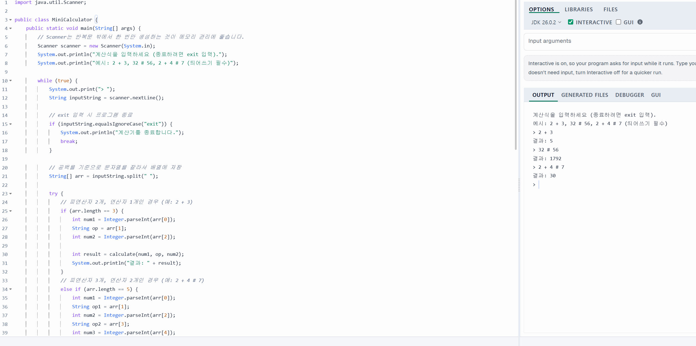

### Homework14

import java.util.Arrays;

class Numbers {
    int num[];
    
    Numbers(int num[]) {
        this.num = num;
    }
    
    double getTotal() {
        double sum = 0;
        for(int i = 0; i < num.length; i++) {
            sum += num[i];
        }
        return sum;
    }
    
    double getArithmaticMean() {
        return getTotal() / num.length;
    }
    
    double getHarmonicMean() {
        double harmonicSum = 0;
        for(int i = 0; i < num.length; i++) {
            harmonicSum += 1.0 / num[i]; // 역수의 합
        }
        return num.length / harmonicSum;
    }
    
    double getGeometricMean() {
        double prod = 1.0;
        for(int i = 0; i < num.length; i++) {
            prod *= num[i];
        }
        return Math.pow(prod, 1.0 / num.length);
    }   
    
    // 중앙값은 짝수 개일 때 소수점이 나올 수 있으므로 반환형을 double로 수정했습니다.
    double getMedian() {
        sorting(); // 중앙값을 구하기 전 반드시 정렬
        if (num.length % 2 == 0) {
            return (num[num.length / 2 - 1] + num[num.length / 2]) / 2.0;
        } else {
            return num[num.length / 2];
        }
    }
    
    void sorting() {
        Arrays.sort(num);
    }
    
    void drawHistogram(int start, int end, int binCount, int scale) {
        // 구간의 크기 계산 (예: 0~100을 10개 구간으로 나누면 크기는 10)
        int binSize = (end - start) / binCount;
        int[] hist = new int[binCount];
        
        for (int i = 0; i < num.length; i++) {
            // 범위를 벗어나는 값 예외 처리
            if (num[i] >= start && num[i] <= end) {
                int binIndex = (num[i] - start) / binSize;
                if (binIndex >= binCount) {
                    binIndex = binCount - 1; // 딱 end 값인 경우 마지막 구간에 포함
                }
                hist[binIndex]++;
            }
        }
        
        System.out.println("\n[ 도수분포표 (히스토그램) ]");
        for (int i = 0; i < binCount; i++) {
            int rangeStart = start + (i * binSize);
            int rangeEnd = rangeStart + binSize - 1;
            
            System.out.printf("%2d~%-2d\t", rangeStart, rangeEnd);
            
            int hashCount = hist[i] / scale;
            for (int j = 0; j < hashCount; j++) {
                System.out.print("#");
            }
            System.out.println(" (" + hist[i] + ")");
        }
    }
    
    void display() {
        System.out.printf("%3d :", num.length);     
        for(int i = 0; i < num.length; i++) {
            System.out.printf("%3d ", num[i]);
        }
        System.out.println();
    }   
}

public class NumbersTest {
    public static void main(String[] args) {
        int size = 100;
        int data[] = new int[size];
        
        // 기하/조화평균 계산 시 0이 들어가면 에러가 발생하므로 난수 범위를 1~100으로 설정
        for(int i = 0; i < size; i++) {
            data[i] = (int)(Math.random() * 100) + 1;
        }
        
        Numbers obj = new Numbers(data);
        
        // 전체 데이터 출력
        System.out.println("[ 생성된 난수 데이터 ]");
        obj.display();
        
        // 통계치 출력
        System.out.println("\n[ 통계 결과 ]");
        System.out.printf("Arithmetic Mean : %5.2f\n", obj.getArithmaticMean());
        System.out.printf("Geometric Mean  : %5.2f\n", obj.getGeometricMean());     
        System.out.printf("Harmonic Mean   : %5.2f\n", obj.getHarmonicMean());       
        System.out.printf("Median          : %5.2f\n", obj.getMedian());      
        
        // 히스토그램 출력 (시작 0, 종료 100, 10개 구간(0~9, 10~19...), 비율 1)
        obj.drawHistogram(0, 100, 10, 1);
    }
}

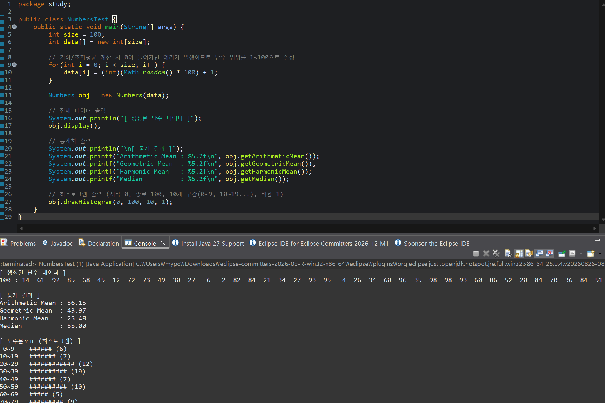
